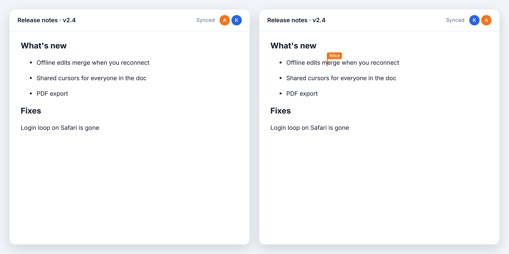

# y-hibira

[](https://www.npmjs.com/package/y-hibira)
[](https://github.com/hibira-io/y-hibira/actions/workflows/ci.yml)

A [Yjs](https://yjs.dev) provider for [Hibira](https://hibira.io) Realtime,
[pusher-js](https://github.com/pusher/pusher-js) and Laravel Echo. Shared
documents and awareness (cursors, names, selections) travel over a private or
presence channel you already know how to authorize, so Tiptap, BlockNote,
ProseMirror, CodeMirror, Monaco, Quill and every other Yjs binding work
without a y-websocket server of your own.

Peers sync with each other through client events (`client-yjs`), so it works
on any Pusher-compatible server with client events turned on.



## Install

```sh
npm install y-hibira yjs pusher-js
```

Turn on client events for the app in the Hibira portal (App → Settings).

## Usage

```js
import * as Y from 'yjs';
import Pusher from 'pusher-js';
import { HibiraProvider } from 'y-hibira';

const pusher = new Pusher(key, {
  cluster: 'hkg', // required by pusher-js, unused once wsHost is set
  wsHost: 'ws.hibira.io',
  forceTLS: true,
  enabledTransports: ['ws', 'wss'],
  channelAuthorization: { endpoint: '/broadcasting/auth' },
});

const doc = new Y.Doc();
const provider = new HibiraProvider(pusher, 'private-doc-42', doc);

provider.on('synced', (synced) => console.log('caught up:', synced));
provider.awareness.setLocalStateField('user', { name: 'Alice', color: '#f97316' });

const text = doc.getText('content'); // bind it to your editor
```

Use a `presence-` channel when you want the member list too: a member whose
connection dies has their cursor removed as soon as the server reports them
gone, instead of after the 30 s awareness timeout.

### Tiptap (v3)

```js
import { Editor } from '@tiptap/core';
import StarterKit from '@tiptap/starter-kit';
import Collaboration from '@tiptap/extension-collaboration';
import CollaborationCaret from '@tiptap/extension-collaboration-caret';

new Editor({
  element: document.querySelector('#editor'),
  extensions: [
    StarterKit.configure({ undoRedo: false }), // Yjs keeps the history
    Collaboration.configure({ document: doc }),
    CollaborationCaret.configure({ provider, user: { name: 'Alice', color: '#f97316' } }),
  ],
});
```

BlockNote takes the same pieces: `collaboration: { provider, fragment: doc.getXmlFragment('doc'), user }`.

### Laravel Echo

```js
const channel = Echo.private('doc.42'); // or Echo.join('doc.42') for presence
const provider = HibiraProvider.fromChannel(channel.subscription, doc);
```

`fromChannel` uses the channel Echo subscribed to and leaves it subscribed on
`destroy()`. Authorize the channel in `routes/channels.php` as usual.

## Saving the document

The server relays client events but does not store them, so a document lives
in the peers that have it open. Keep your own copy for when nobody is
connected. Yjs updates merge in any order and any number of times, so any
client may save:

```js
// Load before connecting.
const saved = await fetch('/docs/42').then((r) => r.arrayBuffer());
if (saved.byteLength) Y.applyUpdate(doc, new Uint8Array(saved));
const provider = new HibiraProvider(pusher, 'private-doc-42', doc);

// Save a few seconds after the last change.
let timer;
doc.on('update', () => {
  clearTimeout(timer);
  timer = setTimeout(() => fetch('/docs/42', { method: 'PUT', body: Y.encodeStateAsUpdate(doc) }), 3000);
});
```

On the server, merge what arrives into what you have:
`stored = Y.mergeUpdates([stored, incoming])` (Node), or store the update
next to the others and merge on read.

## Options

`new HibiraProvider(pusher, channelName, doc, options)`

| Option | Default | |
|---|---|---|
| `connect` | `true` | subscribe right away; otherwise call `connect()` |
| `awareness` | new `Awareness(doc)` | share an existing awareness instance |
| `maxRate` | `8` | client events sent in any second, at most |
| `maxEventBytes` | `4000` | larger messages are split into chunks |
| `answerDelay` | `250` | ms; peers answer a newcomer after a random delay up to this |
| `syncTimeout` | `1500` | ms with no answer after which you are alone, and synced |
| `chunkTimeout` | `30000` | ms to wait for the rest of a split message |

Raise `maxEventBytes` to 9000 on Hobby and Starter and higher plans to send
fewer, bigger events (see [pricing](https://hibira.io/pricing)).

Properties: `doc`, `awareness`, `synced`, `status` (`connecting`,
`connected`, `disconnected`). Events: `synced` / `sync` (boolean), `status`
(`{ status }`), `error`. Methods: `connect()`, `disconnect()`, `destroy()`.

## How it works

- On subscribe a peer sends its state vector (sync step 1).
- Peers answer with the updates it lacks plus their own state vector
  (step 2), after a random delay. A peer that sees an answer already holding
  everything it has stays quiet, so a room of 50 answers about once.
- The newcomer applies the first answer and sends back what that peer lacks,
  so edits made offline reach everyone.
- After that, each local change goes out as an update and each awareness
  change as an awareness update. Updates waiting for their turn under
  `maxRate` are merged into one.
- After a reconnect the provider syncs again; edits made offline, deletes
  included, are merged.

## Limits

| | |
|---|---|
| Channels | `private-` or `presence-`; not public, `private-encrypted-` or `presence-large-` (no client events there) |
| Peers per document | presence channel limit (100 on Hibira) for `presence-`; no limit for `private-` |
| Client events | 10 per second per connection on the server; the provider sends at most `maxRate` (8) and merges waiting updates |
| Event size | 4 KB on the Free plan, 10 KB on Hobby and Starter, more on higher plans; bigger messages are chunked |
| Billing | each client event (each chunk) counts as one message, however many peers receive it |

## Development

```sh
npm test         # unit tests with an in-memory server
npm run test:e2e # against a real server, see test/e2e/provider.e2e.mjs
```

## 中文摘要

`y-hibira` 是 Hibira Realtime 的 Yjs provider，也适用于 pusher-js 和 Laravel Echo。
文档与 awareness（光标、名字、选区）通过 `private-` 或 `presence-` 频道的客户端事件同步，
Tiptap、BlockNote、ProseMirror、CodeMirror、Monaco 等 Yjs 绑定都能直接用，不需要自建
y-websocket 服务器。需在控制台开启客户端事件。提供商会自动限速（每秒最多 8 个事件）、
合并待发更新、把超过大小限制的消息分片；断线重连后会重新同步，离线期间的编辑（包括删除）
都会合并。服务器不保存客户端事件，请按「Saving the document」一节自行保存文档。

## License

MIT
